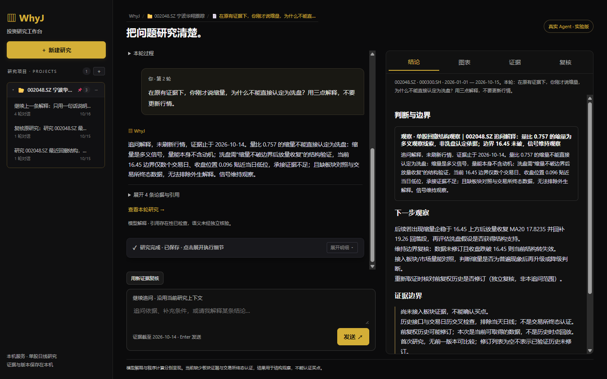

# WhyJ Quant

**Research before conviction.**

An open-source AI research tool for exploring markets, testing ideas, and keeping the evidence. Bring your own models and data sources.

Two product forms share the research foundation: **Desktop for Windows/macOS users** and **CLI/TUI for Linux professionals**, building on the existing terminal, command, and automation capabilities. Desktop currently ships for Windows; macOS delivery and acceptance are pending. See the [product scope](./docs/prd.md#scope). The local Web workspace is a development/validation surface, not a third product line.

[Website](https://oh-my-quant.vercel.app/en/) / [中文](https://oh-my-quant.vercel.app) / [Documentation](#documentation) / [Blog](https://oh-my-quant.vercel.app/en/blog/)

[](https://oh-my-quant.vercel.app/en/)

*Interactive website demo with synthetic data. The CLI runs in your own terminal.*

## Quick start

For Windows Desktop, choose the installer and verify its checksum on the [GitHub Releases page](https://github.com/yangjingo/oh-my-quant/releases). For the CLI, install the [published package](https://www.npmjs.com/package/whyj-quant), then launch the terminal:

```sh
npm install -g whyj-quant
whyj
```

If a Windows npm upgrade is interrupted and `whyj` is unavailable, see [CLI installation recovery](./docs/ci-release.md#recover-an-interrupted-windows-cli-installation) before retrying.

Open `/config` to connect your model and market-data providers. Use `/doctor` to check the setup, then ask a question:

```text
Analyze the returns and risk of 000001.SZ from 2025-01-06 to 2025-06-30.
Show the actual data source, coverage dates, assumptions, and missing inputs.
```

To save reports, enable **Auto Artifacts** in `/config` before submitting a research request. `/artifact` opens existing reports; `/resume` returns to a saved session.

Provider credentials and optional Python dependencies depend on your data sources. Model and data services may charge for usage. See the [configuration guide](./docs/agent-runtime/configuration.md) and [provider reference](./docs/quant-harness/source-data-providers.md).

<details>
<summary>Run from source</summary>

Development requires Node.js 22.19+ and Bun 1.3.14 (the build tool and test runner). From the repository root:

```sh
bun install --frozen-lockfile
npm run dev
```

The checkout and npm release may differ. Check `whyj --version` and the [changelog](./CHANGELOG.md) for the version you are using.

</details>

Source checkouts also include an experimental local Web research workspace: `bun run workspace:dev`, then open <http://127.0.0.1:4175/>. It connects the configured Agent to one explicit-stock daily-bar task, with citations, manual saving and independent review. Requires Python with AKShare and pandas; see [current persistence and recovery boundaries](./docs/agent-runtime/architecture.md#current-web). This entrypoint is not part of the published CLI package or the website demo.

## Features

- **Research in context.** Connect market data and quantitative tools in one conversation.
- **Test an idea.** Explore factors, backtests, and risk with explicit dates and data coverage.
- **Keep the evidence.** Review reports and tool calls, then resume the source research.
- **Work your way.** Choose models, data providers, skills, and workspace preferences.

## Commands

| Command | Purpose |
| --- | --- |
| `/config` | Connect models and data; adjust the workspace |
| `/doctor` | Check the research environment |
| `/portfolio` | Manage observation groups |
| `/skill` | Choose, install, remove, and run skills |
| `/mcp` | Choose and manage MCP presets for Pi |
| `/artifact` | Browse reports and restore their source research |
| `/resume` | Continue a saved session |

Use `/help` in the terminal or `whyj --help` in your shell. Command help provides detailed parameters and one-shot usage; the [command catalog](./src/runtime/workspace/command-catalog.ts) defines the public entries.

## Documentation

- **Use the terminal:** [Configuration](./docs/agent-runtime/configuration.md), [data providers](./docs/quant-harness/source-data-providers.md), [reports](./docs/quant-harness/artifacts-design.md), [tools and skills](./docs/quant-harness/community-tools.md).
- **Product:** [Forms, capabilities, and Quant design](./docs/prd.md).
- **Windows desktop:** [Downloads](https://github.com/yangjingo/oh-my-quant/releases) and [release verification](./docs/ci-release.md#desktop-release-and-website-handoff).
- **Agent Runtime design:** [Runtime, lifecycle, and Pi integration](./docs/agent-runtime/README.md).
- **Quant Harness design:** [Data, computation, execution, and reports](./docs/quant-harness/README.md).
- **System and UI:** [Module architecture](./docs/agent-runtime/architecture.md), [visual design](./DESIGN.md).
- **Read further:** [Investment notes](./notes/README.md), [changelog](./CHANGELOG.md).

Most technical references are in Chinese. The [website](https://oh-my-quant.vercel.app/en/) supports English and Chinese; articles will appear on the [Blog](https://oh-my-quant.vercel.app/en/blog/).

## Development

The package exposes npm script entrypoints. The built terminal and one-shot CLI run on Node. The #76 source branch adds `whyj web [--no-open]` (also with `--json`): this mode starts or reuses a local Host using the CLI's Node or Bun runtime. It is not yet a published release. See the [CLI entry](./apps/cli/README.md) for build prerequisites and the remaining TUI integration.

```sh
npm run dev            # Source CLI with watch mode
npm run build          # Build the Node CLI into dist/
npm start             # Run the built CLI (build first)
npm test              # Test fence, module tests, and repository integration tests
npm run check         # Types, architecture, tests, CLI build, and documentation
```

| npm script | Scope |
| --- | --- |
| `npm run typecheck` | Source, module-local development entrypoints, and root tests |
| `npm run check:architecture` | Production dependency boundaries; excludes manual dev consumers |
| `npm run test:modules` | Tests owned by individual `src` modules |
| `npm run test:integration` | Cross-module checks in `tests/architecture/` and `tests/app/` |
| `npm run test:watch` | Watch both test roots |
| `npm run docs:build` / `npm run check:docs` | Offline blog generation and documentation checks |

Maintenance tools live alongside their owners under `src/<module>/dev/`; there is no shared root scripts entrypoint. Production code cannot import dev tools or test fixtures. Module tests stay inside their module, while repository architecture and application integration tests live in root `tests/`.

Explicit model checks consume provider usage; `--help` does not:

```sh
npm run bench:model -- --help
npm run eval:research -- --help
```

On Windows PowerShell, if the `npm.ps1` shim consumes forwarded flags, use `npm.cmd run bench:model -- --help` (and the same `npm.cmd` spelling for other forwarded commands).

The product website lives in [`site/`](./site/README.md) and has its own build:

```sh
npm --prefix site run dev
npm --prefix site run build
```

## License

[MIT](./LICENSE). Built for thoughtful research.

Research software, not investment advice. Observation groups are not brokerage accounts. Settings, sessions, and reports are stored locally; analysis sends necessary requests to your chosen providers. Review reports before sharing them.
