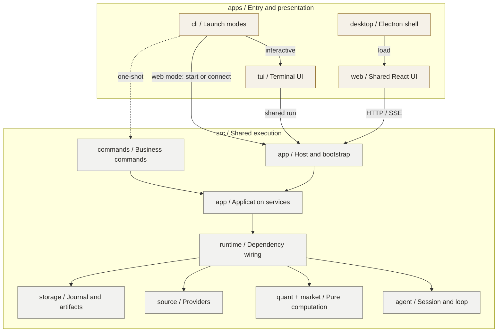

# WhyJ Quant 模块架构

更新：2026-10-26。产品见[PRD](../prd.md)，交互见[UI/UX](../quant-harness/uiux.md)。

## 当前顶层布局

| 位置 | 职责 |
|---|---|
| `apps/cli/`、`src/index.ts` | 模式选择、构建与旧入口桥接；共享终端仍在 #76 验收 |
| `src/cli/` | 单一业务命令注册表与 JSON 单次调用 |
| `apps/tui/` | 终端布局、输入与面板；包含源码、测试和探针，不持有会话真值 |
| `apps/web/` | 共享 React 界面和 HTTP/SSE 客户端 |
| `src/app-runtime.ts`、`src/app-watchlist.ts` | 应用组装与动作；AppRuntime 仍使用界面回调，共享会话投影类型归 `src/types` |
| `apps/desktop/` | Electron、托盘、Host 适配与安装包 |
| `src/app/research-workspace/` | 旧研究宿主与原生 Web UI |
| `src/app/services/` | 无终端回调的 Quant 执行、旧单股复核及元数据协调 |
| `src/app/bootstrap.ts`、`src/app/host/` | 工作区实例发现、认证复用、子进程与客户端生命周期 |
| `src/app/workbench/` | HTTP/SSE 与投影辅助；执行委托 services |
| `src/app/paper-execution/` | 显式私有模拟盘宿主与独立账本 |
| `site/` | 独立静态官网，不连接本地研究数据 |

共享代码仍在 `src/`：agent/runtime 管运行，research/quant/market 管证据与计算，source/storage 管数据，tools/skill/extensions 管能力，artifact/insight 管报告与笔记，performance/execution/alpha 管私有业绩、执行与回测。跨模块契约归 types，专属类型留在模块；详细机制见[模块导览](../quant-harness/README.md)。

旧单股研究工作区的运行与取消由独立[研究宿主](../../src/app/research-workspace/manager.ts)管理，未保存进度只在内存中：页面刷新可接回，服务重启则只从显式保存的对话和固定证据重建上下文，不重放完整 journal 或自动获取新行情。关闭浏览器只断开订阅，不停止任务。首次研究须有结构化发布结果才能保存，后续解释型对话不冒充新研究；复核另开会话取证并关联旧版本。这些现状边界不能由下方目标 Host 的恢复承诺代替。

React 服务见[运行契约](./services.md)，行情与会话见 [Web](../quant-harness/web-ui.md)，发现与停止见 [Host](./host.md)。CLI/TUI 接入正在 #76 验证，完整恢复仍待 #77。

## 当前依赖契约

1. UI 经 facade 交互，不直接修改 Agent、调用 provider 或拼接 `.ohquant` 路径。`runtime` 不导入 CLI/TUI，包括类型；`AppState`、`UIMessage` 等共享契约归 `types`。
2. `quant` 仅依赖自身、无 IO 的 market 和共享类型，不依赖宿主、provider、文件、insight 或 CLI 结果类型。比较取数/身份/保存归 runtime，笔记读取归 insight。
3. source/storage 不相互导入。source 接受 cache/settings 注入，`runtime/data/source-runtime.ts` 绑定 storage；调用方经 storage resolver/API 定位文件。
4. `agent` 接收模型、工具、skills、repo、prompt 和证据端口，默认 IO 在 `runtime/session-dependencies.ts` 组装。`session.ts` 不直接依赖 storage/tools/source/tui；Pi 循环与协议只经 kernel 接入，版本精确对齐，禁止别名绕过。
5. `research` 可依赖 quant、market、storage、types，低层和 TUI 不反向依赖它。Agent/Artifact 共用归档核验；成功工具结果与事件提交绑定，工具不能等待自身 idle。
6. performance、alpha、execution、extensions、skill、quant 的跨模块生产导入只经 `index.ts`，含类型与再导出。performance 不读文件；私有历史适配归 CLI，年报组装归 runtime。执行账本不进入公开行情、组合存储或默认研究上下文。
7. 生产代码不依赖 `dev/`、测试/夹具或 `bun:test`。删除功能先撤入口，另验旧格式/会话兼容，不能顺带删除用户数据。静态依赖检查不是插件沙箱。

runtime 的 evidence 不依赖其他分组，evaluation 是可选消费者；命令目录、Overview 生命周期及展示投影归 workspace。复用[工具注册表](../quant-harness/quant-tools-design.md#registry)。

Pi 负责技能扫描、模型索引及 MCP 连接/认证；skill 负责安装事务，runtime 绑定路径、缓存失效和 MCP 模板，Agent 保留在途快照。安装保护用户修改，不恢复旧资格/审计体系，见[技能契约](../quant-harness/community-tools.md)。

## 目标目录：先拆职责，再迁入口

**图 1 · 多入口与共享执行层（待迁移目标）**

箭头表示调用，虚线表示无需 Host/TUI 的单次命令。

`whyj` 由 `apps/cli` 启动 `apps/tui`；`whyj -c "…"` 执行单次命令，不加载 TUI；`whyj web` 连接或启动 Host 后打开 Web；桌面图标由 Electron 加载同一 Web UI。TUI 保留自绘实现，不意味着改用 Ink，也不新增命令或独立发行包。

Desktop 接入共享 Host 并可关窗到托盘；安装包验收待 #48，CLI Web 与 TUI 接入正在 #76 验证。

先提取 AppRuntime 无界面服务，再接入口；业务不反向依赖 apps。不拆领域 packages 或迁用户数据；同步 bin、构建、安装和测试，保留 CLI/npm、Electron appId 与历史读取，再撤旧入口。

GUI 采用 React＋TypeScript＋Vite，服务采用 Bun HTTP/SSE；不假定 Bun API 可在 Electron Node 运行，不另建 IPC 业务传输。Electron renderer 禁用 Node，保留 sandbox、context isolation、CSP；preload 仅开放受校验的原生能力。

## 目标服务与 Host 契约

入口持有参数、焦点、窗口与订阅；应用服务拥有研究操作与身份/状态；Host 管执行所有权与连接；journal/storage 管已提交事件及不可变成果。[共享 Host 契约](./host.md)集中定义接口、实例兼容、锁/就绪、认证、关窗/退出和恢复边界，仍待对应 Issue 实现。

规划顺序为 #51 → #46 → #75 → #76 → #50 → #47 → #105/#77 → #78 → #48/#56。#98/#102 和提前合入的 #105 应复用；#105 的对话连续性不等于 #77 的工作流恢复。具体前置条件与验收见[顺序表](./host.md#顺序复用与完成条件)。#78 可先补测试发现，跨入口验收在真实能力到位后执行。

当前 Host 实现所有权锁、登记、版本握手与显式停止；本分支接入 CLI/TUI，Electron 尚未接入。目标单次 CLI 可直调无界面服务，共享运行通过 Host 维持唯一所有者。关窗、退订和取消分别处理；不承诺 daemon、全机退出或休眠期间运行。

HTTP 仅绑定 loopback，校验 Host/Origin、token 和参数；renderer 不访问文件或凭证。生产加载静态构建产物，不依赖 Vite。先测 SSE 全量快照增长；若改序号增量，必须支持缺口检测和快照重同步。

| 操作 | 目标语义 |
|---|---|
| 关窗/断开 TUI 或 Web | 释放订阅，运行继续；桌面可从托盘返回 |
| 取消 | 定位具体 run，迟到事件不覆盖终态 |
| 完整退出/停止后端 | 按所有权停止或标记中断并清理，不误杀其他客户端使用的服务 |
| Host 崩溃/重启 | 可找到中断状态，按持久化证据决定是否恢复 |

报告不等于可恢复进度。优先复用 session journal 记录消息、run 状态和关键事件；恢复核对副作用，未知结果先确认，不直接重放。完成后释放 Agent、订阅及临时缓存，历史按需加载；先测长期资源增长，再调整数量上限。

## 测试布局

测试在 `src/<module>/test/`（保留 `source/tests/`）、`apps/{cli,tui}/test/` 与 `tests/app/`；默认/watch/模块测试及类型检查覆盖入口，`dev` 探针不自动发现。[依赖回归](../../tests/architecture/module-boundaries.test.ts)禁止共享层导入入口（启动桥接除外）；[入口回归](../../tests/architecture/development-entrypoints.test.ts)验证发现与构建，违规基线为空。

服务及 HTTP 集成测 `src/app/services/test`，投影测 `src/app/workbench/test`；CLI 启动测 `apps/cli/test`，共享契约归 `tests/contracts`。

`tests/e2e` 用真实 Host、临时工作区和假模型测跨入口接回、关窗继续、精确取消、保存/追问及恢复不重放。随迁移同步发现规则、依赖围栏与 CI。

## 开发入口与 npm 命令

`dev` 保持 CLI/TUI；`dev:web` 联调共享 Host 和 Vite。其他开发入口及安全边界见 [Host 开发与验证边界](./host.md#dev-verification)；Electron 联调待接入。

工具归各模块 `dev/`，CLI 构建归 `apps/cli/dev`；根 `scripts/` 已退役。探针不进入默认 Agent 能力；子进程测试隔离 cwd、配置和服务。

`npm test` 覆盖 src/apps/{tui,cli}/tests；`cli:smoke` 验仓库外 Node 包启动、并发复用与停止；`web:check` 验 Web 类型、测试及生产包不含演示数据，均纳入发布门槛。完整门槛 `bun run check:release` 见[CI/Release](../ci-release.md)。Linux 另验命令、JSON、退出码及无 GUI 运行；Windows 在干净目标机对同一候选哈希验安装、升级与数据保留；macOS 另验构建、原生依赖、签名/公证与安装升级，不能沿用 Windows 结论。
