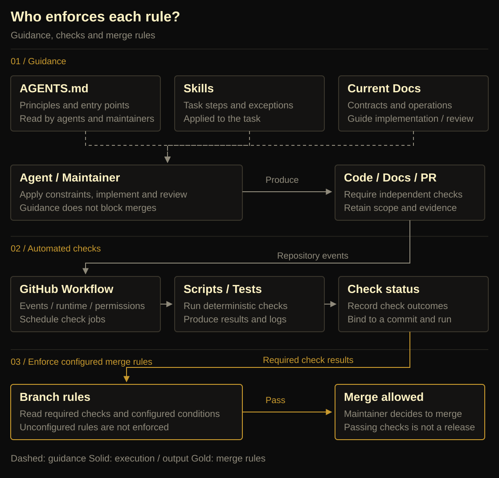
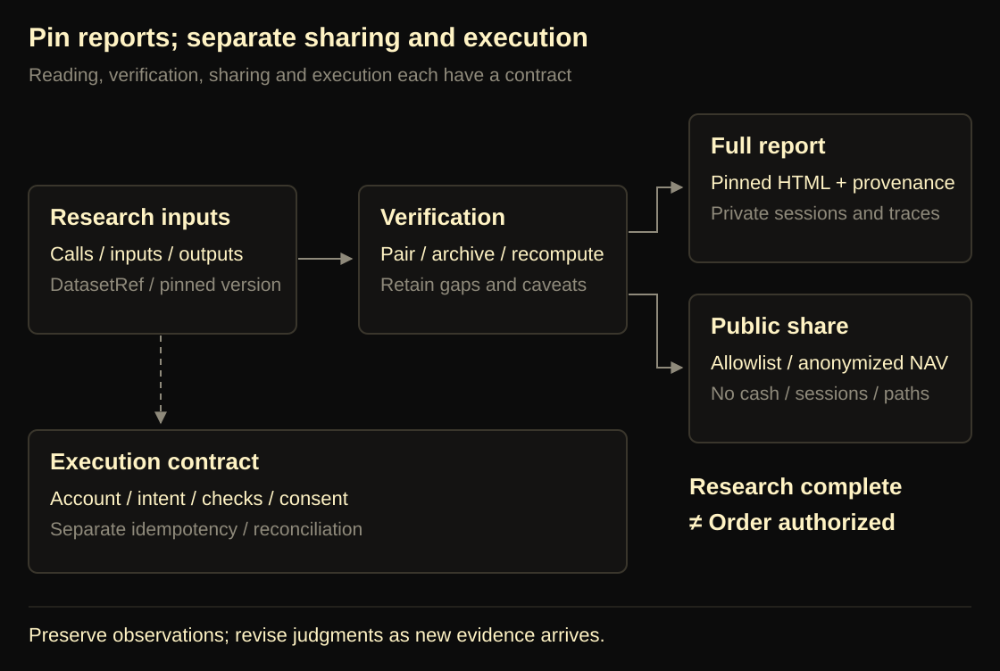
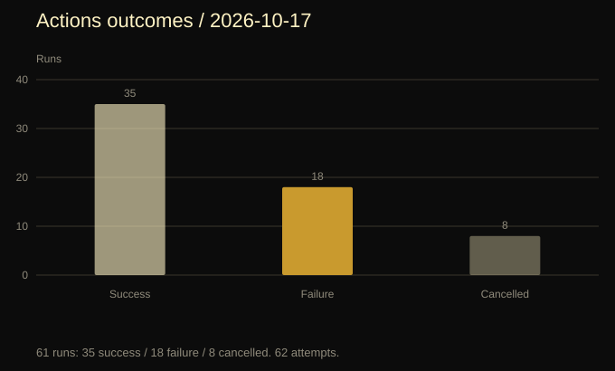
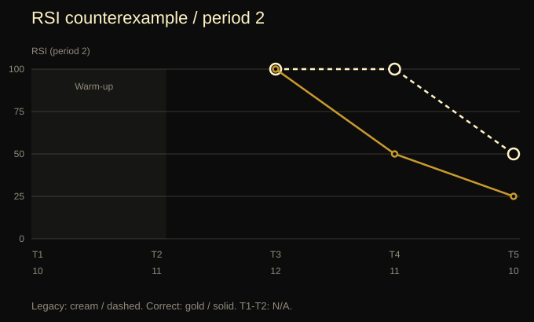
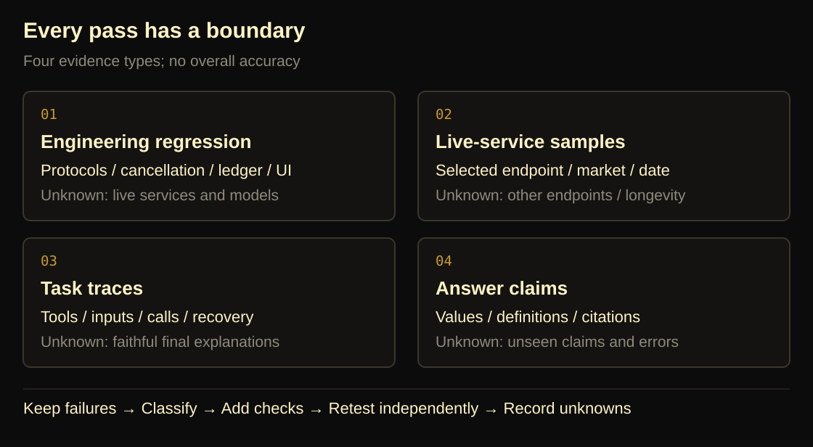
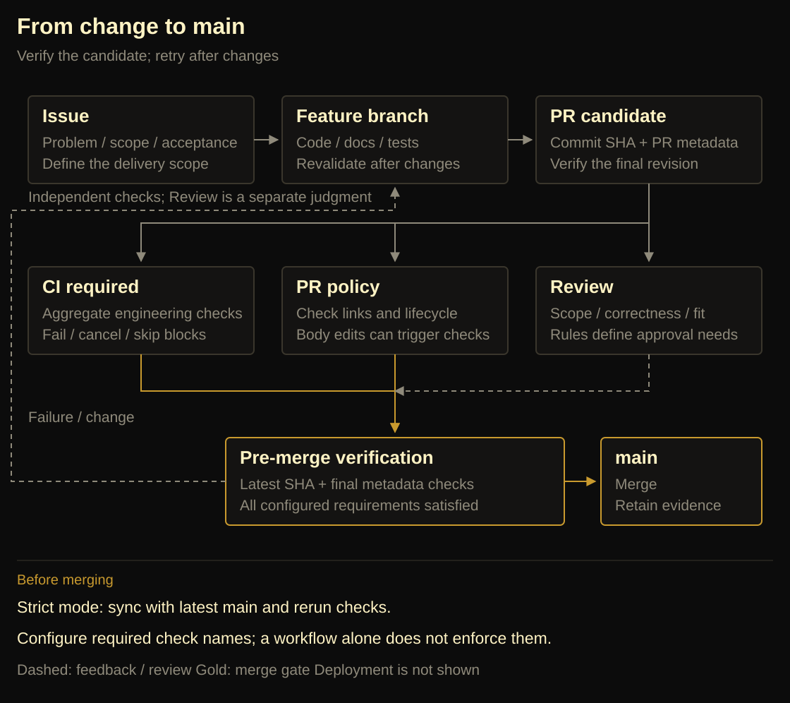

# Agentic / Vibe Repo Ops：代码产出变快以后，仓库怎样继续可信

WhyJ · oh-my-quant 工程实践 · 合并审阅稿 · 2026-10-18

## TL;DR

- Agent 加快了代码、文档和 PR 的产出，也增加了核对它们是否一致的工作；测试全绿只能证明已检查的条件。
- 我们把职责分开：AGENTS.md、Skills 和 Docs 指导执行者，脚本与 Workflow 产出检查证据，分支保护执行已配置的合并限制。
- 完成一次交付，需要核对最终提交、最后一次元数据修改及相应检查。文中失败与修复带有版本和时间边界，不代表当前线上状态或产品整体正确性。

---

让 Agent 参与开发以后，代码、测试、设计文档和 PR 都来得更快。我们原以为，给这些产物补齐检查，就能放心合并。

oh-my-quant 的几次失败推翻了这个判断。测试全绿，独立计算却能发现账本错误；实现已经修复，旧文档仍在指导下一轮修改；代码检查通过，PR 描述触发的新检查却还没结束。每一份产物都像是完成了，它们之间却对不上。

维护者的工作因此多了一层：确认需求、实现、验证和合并决定指向同一次交付。**Agent 交出代码之后，我们还需要什么证据，才能说工作完成了？**

这篇文章沿着这个问题展开：先复盘仓库里出现的失败，再解释我们如何分配 AGENTS.md、Skills、Docs 和 CI 的职责，最后检查修复留下的结果与成本。我们把这组实践称为 Agentic / Vibe Repo Ops。

文中的记录带有时间和版本，不能据此计算 Agent 的缺陷率或生产率；我们没有做这两项测量。

## 一、产出加速后，三个判断失灵了

### 691 项测试通过，账本仍然算错

2026-09-14 的一份核验记录里，项目测试有 691 项通过。同一轮独立回测探针却发现：零费用、本金 100000、买入 1000 股，价格从 100 到 100 再到 110，期末权益应为 110000，函数返回的却约为 111000。另一个先涨 10%、再跌 10% 的例子，累计收益约为 −1%，CAGR 却是 0。

这些是当时的失败观察，不是本文写作时重新运行的结果。后续修复与可重复输入进入了[计算契约](https://github.com/yangjingo/oh-my-quant/blob/cc9c9354b6baf0d0ff71581cf93d43f813e5dbc6/docs/quant-harness/quant-tools-design.md)和[独立账本测试](https://github.com/yangjingo/oh-my-quant/blob/cc9c9354b6baf0d0ff71581cf93d43f813e5dbc6/src/quant/test/backtest-correctness.test.ts)。

问题不在于 691 这个数字不够大。已有断言没有覆盖正确的现金、仓位和年化口径，增加同类断言仍可能漏掉它们。

回答层也发生过类似的事情。2026-10-13，一份对冲回答通过了当时九项自动检查，却把市值 9240 相对成本 10000 的亏损写成 240、2.4%；正确结果应为 760、7.6%。单位、预算和期限检查通过，并没有顺带验证股票情景算术。原始样本属于内部运行材料，这里保留足以理解错误的输入，不把私有会话作为公开附件。

新闻回答的错误更隐蔽：引用格式合法，数字却取自另一段文字；工具说明复权口径未知，回答却将它确定地说成未复权价格。测试检查了格式与调用，读者信任的却是解释。

这使我们重新看待“通过”这个词。一个勾选只有带上它检查的对象和条件，才有意义。

### 文档留下了，当前设计却模糊了

我们最初倾向于保留材料。Agent 写下的方案、历史核验、阶段总结都有可能包含有用信息，立即删除似乎更容易丢失上下文。

但保留原稿没有自动保留正确的历史。一轮清理发现，两份被标为早期与最新的 GOALS，在统一换行、去掉首尾空白后内容完全相同；旧核验说明却声称后一份新增了刷新、分类和 slides。文件没有丢，关于文件关系的解释却错了。

另一类问题发生在实现修复之后。回测已经改为现金与仓位账本，并采用实际日历跨度，文档仍写着“初始名义本金且无现金约束”和统一的 `252/N` 年化简式。如果下一轮 Agent 依据旧规范改代码，修复过的错误就可能重新出现。

旧 Artifact 设计也曾提出独立 recorder、`.traj.jsonl`、DAG 和 replay，而当前实现从 session 分支派生轨迹。两套材料都写得详细，并不使它们同时成为现行设计。读者仍要猜：哪部分已经实现，哪部分只是曾经考虑过？

这些问题与“上下文不够长”并不等价。即使全部读到，如果没有区分材料的身份和有效期，更多上下文仍可能包含相互冲突的指令。[当时的文档与制品复盘](https://github.com/yangjingo/oh-my-quant/blob/cc9c9354b6baf0d0ff71581cf93d43f813e5dbc6/docs/blog/07-artifacts-and-boundaries.md)

### PR 合并了，最后一轮检查还没结束

多个 PR 并行时，共享文档、目录入口与测试说明容易成为交叉修改点。文本冲突只是显眼的一种情况；同一功能被不同 PR 重复实现、架构计划尚未确定而实现位置先被固化，更需要评审发现。

还有一种冲突发生在时间上。2026-10-16，PR #22 的代码 CI 和一轮 policy 已经通过。随后修改 PR 描述，触发新一轮 policy。PR 在这轮检查结束前合并，关联 Issue 自动关闭。检查器稍后读到关闭的 Issue，又按“开放 PR 必须关联开放 Issue”的条件判定失败。[原始失败运行](https://github.com/yangjingo/oh-my-quant/actions/runs/38908970604)

编辑描述、合并 PR、关闭 Issue 都是合理动作，错误发生在它们之间：检查器没有识别对象已经结束，合并流程也没有等待最后一次描述编辑触发的检查。

更早审计 main 时，GitHub API 返回 `Branch not protected`，rulesets 也是空的。仓库里已经有一个名为 `CI required` 的 job，却没有平台规则要求它成功后才能合并。命名表达了意图，设置并未实现这个意图。

**WhyJ 分析：Agent 让我们更容易同时生成和修改多个产物，也让维护者更频繁地面对它们之间的关系。** 这些故障并非 Agent 开发独有；在本仓库里，它们共同暴露了一个薄弱点：需求、实现、证据和合并决定之间缺少足够明确的对应关系。

## 二、把“完成”拆成可复查的责任

### 用 Issue 和 PR 固定交付范围

面对这些问题，一个自然反应是扩写 AGENTS.md，把所有教训都放进去。我们最终选择让入口保持简短，把需要不同执行者承担的事情分开。

首先约束交付单元：一份实现 Issue、一个主要功能模块、一个实现 PR。Issue 写清问题、允许修改的路径、非目标，以及可以观察的验收条件。PR 对应说明改变了什么，用什么证据支持完成。

“主要模块”不意味着只能修改一个目录。CI 的生命周期修复可能同时涉及 YAML、策略脚本、测试 fixture 和操作文档；为了满足目录数限制把它们拆散，反而会破坏同一问题的完整交付。我们希望限制的是语义范围，让评审者知道这次工作究竟承诺了什么。[Issue Skill](https://github.com/yangjingo/oh-my-quant/blob/cc9c9354b6baf0d0ff71581cf93d43f813e5dbc6/.agents/skills/issue-skill/SKILL.md)

这也改变了我们对评审的要求。评论应该指出具体触发条件、影响和修复目标。例如：两个标签页基于同一快照编辑不同项目，后提交可能覆盖前一个新增项目；这需要检查过期写入或更新粒度。让作者顺便替换框架、整理无关命名，只会扩大当前问题。

这类元数据写入风险来自固定版本的 PR 审查，不能因为本文引用它，就把它写成已经合入的产品修复。评审方法由 [review-skill](https://github.com/yangjingo/oh-my-quant/blob/cc9c9354b6baf0d0ff71581cf93d43f813e5dbc6/.agents/skills/review-skill/SKILL.md) 维护；发现问题、实施修复与最终验证分别需要证据。

### 让规则找到执行者

我们按“谁真正执行这条规则”重新分配责任：

| 放在哪里 | 承担什么 | 本仓库中的例子 |
| --- | --- | --- |
| `AGENTS.md` | 稳定原则与知识入口 | 理解范围、保护已有改动、让结论对应验证 |
| 仓库 Skills | 特定任务的操作步骤与例外 | 完成 PR 描述后，再核对最后触发的检查 |
| 当前 Docs | 实现契约、命令与维护方法 | 数据口径、模块职责、CI 和发布操作 |
| 脚本与测试 | 可机械判定的条件 | 检查 Issue 引用、账本不变量、依赖边界 |
| GitHub Workflow | 调度事件、版本、环境和权限 | 哪个提交在 Linux、Windows 上执行什么 |
| 分支保护 | 接收合并时执行限制 | 必需检查通过，分支与 main 保持同步 |
| Blog | 解释为什么作出这些选择 | 失败反例、被推翻的判断、成本和重审条件 |

这些层次彼此连接，但不能互相代替。Skill 说“等待 CI”不等于 GitHub 已阻止提前合并；YAML 跑了检查不等于它覆盖业务语义；模板里填了 Verification，也不等于作者真的验证了最终代码。



*图 1｜规则的执行边界：文件提供指导，脚本执行检查，平台实施已配置的合并限制。图示整理本文的职责关系，不代表本轮读取了线上设置。*

我们在 AGENTS 中保留原则与 Skill 索引，具体操作分别交给 issue-skill、pr-skill 和 review-skill。若确定性条件可以由脚本判断，就让脚本拒绝，而不是每轮依赖 Agent 重新理解同一段文字。[仓库入口](https://github.com/yangjingo/oh-my-quant/blob/cc9c9354b6baf0d0ff71581cf93d43f813e5dbc6/AGENTS.md)

这也有成本。“每个 PR 修改 docs Markdown”可以被路径检查强制，但脚本不能判断那句话有没有价值。为了通过检查而改一个标点，并没有补齐行为说明。因此文档门槛仍需要评审解释其相关性；普通小修也不需要强行产出一篇博客。

### 按读者任务合并文档

我们的第一次整理仍然保守：把旧稿汇成 13 份主题归档，再建一份设计决策账。入口看起来少了，但读者仍要在当前规范、历史汇编、决策账和博客之间拼出答案。阅读负担只是换了位置。

后来删除归档与决策账，把现行契约放回 Docs，把错误判断、修正理由和代价直接写进 Blog。继续检查才发现，research-*、skill-* 仍把一个生命周期拆在很多页里：任务 ID 一处要求必填，另一处已经允许首次声明由宿主补齐。只删除 archive 并没有解决重复规范。

那轮工作最终把 16 份相关文档收敛为 Harness、Skills、量化工具、数据源和 UI/UX 五个主入口，吸收并删除了其中 11 份。它减少了同一责任的重复解释，也让主文档变长、部分旧链接失效。这里能确认的是结构与冲突的变化，不能据此宣布读者理解速度提高。

第三方 Skill 的功能目录也遵循同样判断：上游维护功能介绍，我们维护采用的版本、安装与发现方式、本地装配边界。复制整个上游目录，会多出一份随时可能过期的说明。移除重复说明不等于移除运行依赖，用来复现错误的测试 Skill 夹具也不能顺手删掉。

代码中的辅助材料同样需要身份。开发脚本归所属模块的 `dev`，跨模块集成测试归根 `tests`，生产代码不能反向依赖这些入口。默认回归通过围栏检查后运行 `src` 与 `tests`；生成报告的演示用例使用显式入口，参考仓库的测试不混入默认集合。否则连一次失败是否属于产品回归，都需要临时猜测。[测试入口与围栏](https://github.com/yangjingo/oh-my-quant/blob/cc9c9354b6baf0d0ff71581cf93d43f813e5dbc6/package.json)

### 淘汰重复规范，保留失败证据

文档整理还需要另一条边界：设计应当更新，历史观察应当固定。

一份报告保存为 `id@revision` 后，应该继续呈现当时保存的 HTML、元数据与 provenance。原数据缺失就标记 unavailable，不能拿今天缓存中的相似曲线填回昨天的研究。恢复时核对源 entries、顺序、分支关系和内容指纹，也不能只凭“页面还能打开”就认定证据完整。[Artifact 契约](https://github.com/yangjingo/oh-my-quant/blob/cc9c9354b6baf0d0ff71581cf93d43f813e5dbc6/docs/quant-harness/artifacts-design.md)

但保存字节不意味着永远保留核验资格。修正 RSI 公式以后，如果旧报告不能按归档输入重现，就应该保留旧结果，同时撤销原来的 verified 判断。离线修改检查器后重读一份回答，也只能得到新的重审结论，不能把旧失败改写成一次新的模型成功。

这个区别同样适用于删除旧设计。我们放弃独立 recorder、复用 session 分支来派生轨迹，减少了两套记录的身份和顺序协调；代价是只能呈现实际捕获的事件，不能补出未记录的决策，也不承诺任意执行重放。真实的跨进程因果需求若超出当前表达能力，再重新考虑独立记录器。

旧方案里的独有约束还必须迁移。曾有一次摘要漏掉了采集限制：可审计事件与可展示的推理摘要，不等于模型底层隐藏思维链原文；新增采集器也不应收集系统提示、密钥和认证材料。这些约束需要保留，不能被当成现有报告已经完成全面过滤的证明。

完整研究报告仍可能包含用户原文、资金金额、内部路径和可见会话记录，应按私有材料处理。公开分享另从白名单数据构造，放弃完整会话与私人研究的可恢复性；研究完成也不意味着获得账户下单授权。报告保存、公开分享、真实执行，各自有单独的契约。完整报告部分图表还依赖 CDN，分享副本的本地 CSS/SVG 路径不能替它证明离线能力。[报告与分享实现说明](https://github.com/yangjingo/oh-my-quant/blob/cc9c9354b6baf0d0ff71581cf93d43f813e5dbc6/src/artifact/README.md)



*图 2｜报告、分享与执行的边界。根据 WhyJ / oh-my-quant [第 07 篇原图](https://github.com/yangjingo/oh-my-quant/blob/cc9c9354b6baf0d0ff71581cf93d43f813e5dbc6/docs/blog/images/07-artifacts.svg)改绘；三类产物各有职责，图示不代表本轮运行验收。*

这也是合并博客时最需要保住的东西：可以改变材料的组织方式，但不能补写不存在的需求、删掉独有约束，或者把历史失败润色成一条从未走错的路线。

## 三、让检查对准真正的失败

### 先检查失败发生在哪一层

开始排查 Actions 时，我们没有只盯着最新一个红灯，而是分页读取历史 runs，继续检查 jobs、steps、attempts 与可取得的 artifacts。2026-10-17 冻结的扩展快照有 61 次 run：35 成功、18 失败、8 取消，共 62 个 attempt。后续修复运行不混入这个分母。

多出来的 attempt 很关键。[一次最终成功的 run](https://github.com/yangjingo/oh-my-quant/actions/runs/39039089298/attempts/1)，首次尝试其实因 Windows 取消测试失败。如果只查询最终状态为 failure 的运行，就会漏掉它。反过来，一个平台测试失败会让平台 job 与聚合门槛同时变红，也不能算成两个独立缺陷。



*图 3｜先分清统计对象，再解释红灯。来源：[2026-10-17 历史审计记录](https://github.com/yangjingo/oh-my-quant/blob/cc9c9354b6baf0d0ff71581cf93d43f813e5dbc6/docs/blog/agentic/vibe-repo-ops.md)。这是冻结记录的重绘，本轮未刷新 Actions；设置中可切换分母与统计单位。*

把取消保留在分母中，失败占比是 18/61，约 29.5%；只看成功或失败的运行，分母变为 53，占比约 34.0%。这两个数描述同一份快照，变化来自统计口径，不能解释为可靠性变差。图中没有把“失败 run”转换成“独立缺陷”，也没有据此估计修复后的提升。

这次审计逐渐把问题分成几类：真实产品行为错误、测试前提与环境不符、异步工作与清理竞态、策略版本或生命周期错误，以及工具链与安装阶段故障。同样是红灯，修复位置完全不同。

例如，多行粘贴时第二行不可见，是用户会遇到的产品问题；Linux 测试使用 `C:\private-paper`，是 fixture 误用了 Windows 路径；干净 Windows 上还没有卸载注册表根键，是安装验收前提需要处理。把它们统一称为 flaky，再统一增加等待时间，会抹掉最有价值的区别。[产品失败](https://github.com/yangjingo/oh-my-quant/actions/runs/38234986954)、[路径失败](https://github.com/yangjingo/oh-my-quant/actions/runs/38602368594)、[安装前提失败](https://github.com/yangjingo/oh-my-quant/actions/runs/38591545423)

### 测试要有独立的判断依据

对账本错误，我们采用独立现金与股数计算生成预期值。在定义好的成交价格约定下，至少核对：

```text
cash[t] = cash[t-1] - tradeShares[t] × price[t] - cost[t]
equity[t] = cash[t] + positionShares[t] × price[t]
```

如果期望值也调用被测函数生成，测试可能只是在确认函数与自己一致。这些不变量能检出一类算术错误，但真实成交、停牌、滑点与复权仍需要各自的条件。

样本也必须能区分错误实现。旧 RSI 在递推时重复消费播种期末变化，持续上涨时，新旧结果都可能是 100。换成收盘价 `[10, 11, 12, 11, 10]`、周期 2，正确末两项为 50、25，旧实现却为 100、50。再增加十个单调上涨样本，也不如这个转折样本有效。



*图 4｜转折让旧实现暴露出来。转折输入与正确结果来自[独立回归用例](https://github.com/yangjingo/oh-my-quant/blob/cc9c9354b6baf0d0ff71581cf93d43f813e5dbc6/src/quant/test/factor-method-regression.test.ts)，旧结果来自[第 05 篇失败记录](https://github.com/yangjingo/oh-my-quant/blob/cc9c9354b6baf0d0ff71581cf93d43f813e5dbc6/docs/blog/05-evaluation-beyond-green.md)。前两项为 N/A。设置中的上涨对照 `[10, 11, 12, 13, 14]` 是构造输入，用来说明单调上涨为何漏掉错误；不属于历史实测。*

切换到上涨对照，两条线都停在 100，测试就无法区分这两种实现。切回转折，第四次观察已经出现差异：正确计算消费了新出现的下跌，旧结果仍滞后。选择反例的价值，在于让错误假设和正确行为产生可观察的不同，而不是单纯增加测试条数。

回答层则把已经观察到的错误变成有限检查：显式股数、成本和收盘价交给无 IO 的情景计算，再核对能识别的股票算术；评分通过贡献与合计检查，区分“原始分最高”和“加权贡献最大”。这些规则不会自动证明任意自然语言解释正确，更不核验完整期权策略。后续样本即使股票算术正确，仍可能作出缺少同条件报价的保费比较。[持仓情景计算](https://github.com/yangjingo/oh-my-quant/blob/cc9c9354b6baf0d0ff71581cf93d43f813e5dbc6/src/quant/position-scenarios.ts)、[有限回答检查](https://github.com/yangjingo/oh-my-quant/blob/cc9c9354b6baf0d0ff71581cf93d43f813e5dbc6/src/runtime/evidence/hedge-scenario-answer.ts)

因此我们把确定性工程回归、真实服务样本、任务轨迹与回答主张核对分开理解。前一层通过，不能替后一层签字。真实服务的一次成功也只覆盖选定连接、权限和时间窗口，不代表长期可用。



*图 5｜四类验证与各自的未知。根据 WhyJ / oh-my-quant [第 05 篇原图](https://github.com/yangjingo/oh-my-quant/blob/cc9c9354b6baf0d0ff71581cf93d43f813e5dbc6/docs/blog/images/05-evaluation.svg)改绘；各层证据相互补充，不能折算成未经定义的总体正确率。*

### Windows 超时暴露的是资源生命周期

有一项研究评测在约 5.4 秒时被测试框架终止，内部操作却默认允许 120 秒。外层开始删除目录、恢复环境时，内部 HTTP、归档和后续回答可能仍在运行，随后出现迟到断言或目录不存在错误。[失败运行](https://github.com/yangjingo/oh-my-quant/actions/runs/38680849899)

把外层期限调大可以减少一次过早中断，却没有回答：如果下一次仍然超时，谁负责停止内部工作？

我们在测试 fixture 中显式持有 AbortController 和在途 Promise。清理时先禁止新工作进入，再发出取消，等待已有工作结算，然后停服务器、清定时器、恢复环境与删除临时目录。测试操作预算设为 10 秒，文件内测试预算 30 秒，清理预算 15 秒；这些是 fixture 的预算，没有修改生产评测默认值。[修复后的测试](https://github.com/yangjingo/oh-my-quant/blob/cc9c9354b6baf0d0ff71581cf93d43f813e5dbc6/src/runtime/test/research-evaluation.test.ts)

这里真正改变的是事件顺序：

```text
结束测试 → 拒绝新任务 → 取消在途工作 → 等待退出 → 释放资源
```

`abort()` 发出信号，只能证明请求取消，不能证明再也没有回调。YTD 归档测试进一步说明，等待一个底层 `saveBars` 也可能不够，因为测试体随后还会创建另一份归档。清理需要等待完整的资源使用者结束。若 Promise 无限挂起，预算仍应报告失败，不能把“等待结算”写成 JavaScript 可以强制终止任意工作。[归档测试](https://github.com/yangjingo/oh-my-quant/blob/cc9c9354b6baf0d0ff71581cf93d43f813e5dbc6/src/runtime/test/research-decisions.test.ts)

取消测试还有另一处错误：旧用例从命令启动开始计时，再要求取消小于 1000ms。Windows 上请求发出前的准备时间也被算进来，测试因此混合了启动耗时与取消行为。

新用例等服务器实际收到请求后才取消，并让正常响应停在一个受控关口。命令必须在响应尚未放行时结束，同时保留取消原因、没有成功结果、streaming 已停止等断言。外层期限用来发现挂死；取消语义由事件先后验证。如果产品忽略取消，命令就会一直等正常响应，测试仍然失败。[取消回归](https://github.com/yangjingo/oh-my-quant/blob/cc9c9354b6baf0d0ff71581cf93d43f813e5dbc6/src/runtime/test/skill-command-cancellation.test.ts)

Doctor 的问题则来自机器环境。测试假设没有提示，隐含要求开发机已装好 Python/AKShare；另一项 handler 测试即使跳过网络，仍可能执行真实 Python 探针。前者需要显式构造缺依赖并检查结构化失败，后者使用已有依赖注入边界提供确定的就绪结果。测试应该声明它要的世界，而不是偶然继承维护者的电脑。[入口回归](https://github.com/yangjingo/oh-my-quant/blob/cc9c9354b6baf0d0ff71581cf93d43f813e5dbc6/tests/app/index.test.ts)、[handler 失败运行](https://github.com/yangjingo/oh-my-quant/actions/runs/39047623864)

### 策略检查也必须对齐版本和状态

PR policy 曾两次报找不到 `.github/scripts/pr-policy.mjs`。工作流已经更新，但 checkout 使用旧 PR payload 里的 `base.sha`；那个提交早于脚本引入。结果是新工作流执行旧代码，两个版本在同一 job 中相遇。[第一次失败](https://github.com/yangjingo/oh-my-quant/actions/runs/38907862456)、[再次失败](https://github.com/yangjingo/oh-my-quant/actions/runs/38918415702)

只让一个 PR 同步 main 可以暂时避开问题，下一个旧 PR 还会再失败。修复落在事件与策略版本的对应关系上：该 `pull_request_target` 工作流使用事件的 `github.sha` 检出可信策略，并记录策略 SHA 与 PR head。

这个 job 只读取 PR 描述、文件和 Issue，不检出 PR head，不安装 PR 依赖，也不执行 PR 提供的脚本。权限限于 contents、issues、pull-requests 的 read，checkout 不持久保存凭证。贡献者提交的内容是检查输入，不能同时成为决定自己是否合格的可信检查器。[策略工作流](https://github.com/yangjingo/oh-my-quant/blob/cc9c9354b6baf0d0ff71581cf93d43f813e5dbc6/.github/workflows/pr-policy.yml)

这一选择依赖 GitHub 的事件语义，维护时仍要核对[官方事件说明](https://docs.github.com/en/actions/reference/workflows-and-actions/events-that-trigger-workflows)。不能把 target 工作流的 checkout 方式直接复制到普通代码测试，更不能把两种事件的权限边界混为一谈。

针对“合并后 Issue 关闭”的误报，策略增加了生命周期判断：开放 PR 的无效 Issue 仍然拒绝；PR 已关闭或合并则返回不适用；API 错误不能被当成成功。每轮校验前后重新读取 PR，若 body、head、base 或文件数变化，最多重试三轮；持续变化则明确失败，要求重检。[策略脚本与回归](https://github.com/yangjingo/oh-my-quant/tree/cc9c9354b6baf0d0ff71581cf93d43f813e5dbc6/.github/scripts)

重新读取减少了旧快照误判，却没有让多次 REST 请求成为事务。最后一次读取之后 Issue 仍可能改变，当前工作流也没有覆盖所有 Issue-only 变化。因此我们没有宣称得到原子唯一性或完全一致的合并服务。

稳定快照上的机械条件也尽量具体：一个规范的关闭引用指向一个开放 Issue，正文包含 Outcome、Scope and Documentation、Acceptance、Verification、Visual Evidence、Risks and Rollback，存在非删除的 docs Markdown 改动，并检查其他开放 PR 是否已用可识别的关闭引用关联同一 Issue。它们能发现缺项与已知冲突，却不能证明范围合理、截图对应最终代码，或文档真的解释了行为变化。

操作流程也必须配合：先完成 PR 描述，再检查最后触发的运行。同一个 head 上，旧成功和新 pending 可以同时存在。“最终代码 SHA 通过过”仍不足以证明最终描述已经检查。[PR Skill](https://github.com/yangjingo/oh-my-quant/blob/cc9c9354b6baf0d0ff71581cf93d43f813e5dbc6/.agents/skills/pr-skill/SKILL.md)

### 四条工作流分别回答四个问题

我们保留四个 workflow，让代码回归、协作策略、安装包验收和真正发布有明确分工。

| 工作流 | 触发与职责 | 结果的边界 |
| --- | --- | --- |
| `CI` | PR、main push、手动或复用调用；Linux/Windows 完整 release gate | 检查规定的代码、文档与打包入口 |
| `PR policy` | PR 打开、编辑、同步等；读取可信策略 | 检查 Issue 引用、正文结构与 docs 改动，不裁定全部语义 |
| `Windows desktop` | PR、main push、手动；构建并安装实际交付程序 | 检查指定 Windows runner 上的安装与交互 |
| `Publish npm` | 手动输入 main 上的确切稳定版本，默认 dry-run | 分开发布预演与真实上传 |

根 CI 固定 Bun 1.3.14，使用 Node 24 和 frozen lockfile，在 Linux、Windows 上运行类型、架构、策略、测试、CLI 构建与文档检查。Node 固定到主版本，并非所有工具都固定到补丁版本；第三方 Actions 当前也仍使用版本标签，不能把这套配置描述为所有依赖已经锁定到提交。

两个平台使用 `fail-fast: false`，让一个平台失败后，另一个仍有机会留下证据。执行输出写入日志，同时检查原命令退出码，避免日志管道掩盖失败。日志在结束时尝试上传并保留 14 天；没有文件就不能声称已经取得诊断。

随后对 npm 包做一次更接近使用者的检查：打包，安装到 checkout 外的临时目录，运行实际包中的 Node CLI，校验 JSON 版本。它能发现只在源码目录成立的入口假设，但 `--version` 成功仍不能证明所有真实行情、模型和 UI 功能可用。

最后，`CI required` 以 `always()` 执行，只接受矩阵结果为 success。failed、cancelled、skipped 都不能被聚合成成功。聚合器的意义在于给分支保护一个稳定名称，同时明确它到底依赖哪些检查。[CI 实现](https://github.com/yangjingo/oh-my-quant/blob/cc9c9354b6baf0d0ff71581cf93d43f813e5dbc6/.github/workflows/ci.yml)

Desktop 曾只在较晚阶段暴露安装问题，因此我们把它放到所有 PR 上，包括只改文档的 PR。目前接受这笔成本，换取稳定报告的检查；以后若按路径裁剪，仍需设计一个始终返回结论的入口，避免必需检查永远 pending。PR 和 main 已有根 CI，Desktop 不再重复跑一份根检查；手动构建则复用完整 CI，真正发布依赖检查和安装验收两者成功。[Desktop 实现](https://github.com/yangjingo/oh-my-quant/blob/cc9c9354b6baf0d0ff71581cf93d43f813e5dbc6/.github/workflows/desktop.yml)

并发策略也按对象区分：同一 PR 的旧运行可以取消，main 和手动发布不因新运行主动取消在途任务。但 GitHub concurrency 不是持久化 FIFO 队列；`cancel-in-progress: false` 不能被理解为每个排队请求都会执行。若将来需要发布排队语义，需要单独设计。

发布权限只出现在需要写操作的 job。Desktop 发布检查 main、CLI/Desktop 稳定版本一致，上传验收过的安装包与 SHA-256；npm 发布复用 CI，以 OIDC Trusted Publishing 为目标配置，只给发布 job `id-token: write`。npm 的 `prepublishOnly` 还会再次执行生成与 release gate，带来重复验证成本。[npm 发布实现](https://github.com/yangjingo/oh-my-quant/blob/cc9c9354b6baf0d0ff71581cf93d43f813e5dbc6/.github/workflows/npm-publish.yml)

预演只证明执行了预演路径，不证明 npm 端的信任关系已经生效。构建得到 exe，也不证明所有用户机器的签名、杀毒与 Code Integrity 策略都会接受它。我们把这些保留为不同的验收阶段。

### 让 main 等待必需检查

配置分支保护时，需要填写的是稳定的检查名称，例如 `CI required`、`PR policy`，不是工作流标题 `CI`。保存以后还要重新读取平台设置，确认 required checks 中确实存在这些条目。仅仅在搜索框输入名称，并不代表已经添加。

`Require branches to be up to date before merging` 对应 strict 检查：要求分支与最新 main 对齐后再验收。它减少“分支自己通过，合在一起出错”的风险，代价是 main 更新后需要同步和重跑。前提是已经指定至少一个必需检查。[GitHub 分支保护说明](https://docs.github.com/en/repositories/configuring-branches-and-merges-in-your-repository/managing-protected-branches/about-protected-branches)



*图 6｜从改动到 main：自动检查与评审判断各有职责，合并门槛取决于平台配置。虚线表示反馈或评审关系；是否强制审批、是否要求同步最新 main，均需核对实际规则。*

另外几个开关解决的是不同问题。签名提交验证提交来源与内容完整性，不能证明代码正确；线性历史禁止 merge commit，可配合 squash 让 main 上一条提交对应一个 PR，但不能保留完整的逐步调试结构；部署成功要求选定环境已经成功部署，前提是确实存在这样的部署流程；Lock branch 则使分支只读，不适合日常持续集成的 main。

在个人维护阶段，我们选择保留 PR、CI 和最新基线约束，没有强制另一位 reviewer 批准，也暂不要求 Agent 提交必须签名。这是在当前账号与维护成本下的取舍，不能解释为 Agent 无法签名。PR #39 曾因三个未签名提交而被拒绝合并，说明一项来源规则确实会独立于绿色 CI 生效；解除它不会自动解除其他规则。

对于线性历史，本文倾向短期 issue 分支配合 squash，让 main 上的变更与 PR 更容易对应。启用前要确认已有 PR 的依赖方式和合并习惯，尤其是堆叠分支；它也不能保证回滚无冲突。截至本文设置快照，该开关仍未开启。

合并后的分支清理同样不能只靠一句“删掉多余分支”。需要确认实际合入、没有依赖分支和未交付提交，再分别处理远端 ref 与本地 worktree；后者可能保存未入库的证据和私人数据。远端自动删除开关也不会代替本地清理。短期分支减少长期分叉，清理流程则负责保住尚未交付的工作。

## 四、修复的结果与维护成本

### 用故障注入检查修复

仅在维护者的快机器上重新通过，不能证明 Windows 的问题已经解决。我们为关键修复做了对照，也刻意破坏正确行为，检查测试是否还会拒绝。

| 对照输入 | 旧测试或错误实现 | 修改后的结果 |
| --- | --- | --- |
| 请求进入 fixture 前增加 1100ms 准备时间 | 三条取消路由都因总耗时断言失败 | 三条路由通过；取消完成时正常响应仍未放行 |
| 临时副本不再向 handler 传取消信号 | 命令等待尚未放行的响应 | 新测试三条路由均失败，保留对取消失效的检出能力 |
| 每次归档 fixture 增加 5500ms 延迟 | 外层 5 秒先超时 | 新测试约 11.8 秒完成，原证据范围断言通过 |
| 保留慢归档，把外层期限故意缩为 1 秒 | 仍然制造测试超时 | 新清理等待工作结算，没有伴随 ENOENT 或迟到未处理错误 |

这些对照使用临时验证副本，故意引入的错误没有进入生产代码。它们支持的是几个具体结论：启动耗时不会再冒充取消语义；正常取消仍必须发生；超时仍然会失败；清理顺序不再依赖正常路径恰好很快。它们不能证明所有异步竞态已经消失。

这也是我们现在判断测试修复时更看重的一点：**减少误报以后，检查还是否保留拒绝真正错误的能力？** 只删除断言、吞掉异常或无限扩大期限，可能让图标变绿，却失去这项能力。

### 把结果绑定到版本

截至 2026-10-18 本文核对时，CI 与工作流修复 PR #41 已合入，main 为 `cc9c935`。合并后同一提交的[根 CI](https://github.com/yangjingo/oh-my-quant/actions/runs/39053926566)和[Windows Desktop](https://github.com/yangjingo/oh-my-quant/actions/runs/39053928922)均成功。这比“本地检查通过”多了一层真实平台证据。

但后续还有一个独立问题：Overview 恢复测试对比整个面板，真实时钟恰好从 17:15 跨到 17:16 时，只因刷新时间变化而失败。修复在 PR #42 中固定墙上时钟，显式跨越分钟边界，同时保留真实定时器和整块面板断言，避免通过忽略时间字段掩盖显示错误。[原失败运行](https://github.com/yangjingo/oh-my-quant/actions/runs/39052800266)、[修复 PR](https://github.com/yangjingo/oh-my-quant/pull/42)

该 PR 在核对时仍是 OPEN，head 为 `1cdbcd1`。其 [CI](https://github.com/yangjingo/oh-my-quant/actions/runs/39054251705) 对合并候选 `79abc16` 报告 Windows 2686 项通过、Linux 2678 项通过及 8 项平台跳过，无失败；[Desktop 运行](https://github.com/yangjingo/oh-my-quant/actions/runs/39054251765)与[最终描述的 policy](https://github.com/yangjingo/oh-my-quant/actions/runs/39055002948)也成功。安装回执包含 11 项应用检查与 4 项安装器检查。这些是候选版本的结果，不能算成 main 已包含该修复。

分支保护的同一轮快照中，必需检查为 `CI required` 和 `PR policy`，strict 已开启，管理员也受约束。`Desktop required` 已有全 PR 工作流覆盖，但还没有加入必需列表；签名与线性历史均未强制。仓库也未启用合并后自动删除远端分支。因此，检查存在、检查通过、检查强制、分支已清理，是四件需要分别确认的事情。

Actions 的仓库默认 token 权限为 read，未允许工作流创建并批准 PR；允许使用的 Actions 范围仍为 all，也没有平台级的完整 SHA 固定要求。这说明最小写权限已经在默认设置和具体 job 中有所落实，第三方 Action 的来源约束却没有同时收紧。以后若调整，应该先盘点正在使用的 Action 与更新方式，而不是把一个开关的开启描述为整个供应链已经可信。

这里记录的是有时间边界的设置快照，后续应以平台实时状态为准。我们尚未完成一个故意失败、再尝试合并并确认被 CI 规则拒绝的完整受控验收，不能把配置读取当成所有拒绝路径都经过实测。

### 规则也有维护成本

现在，一些历史失败有了明确归属和可重复输入；策略与工作流版本对齐，开放与结束的 PR 分开处理；测试持有自己的异步工作，取消后等待退出；根 CI 与 Desktop 的职责更清楚，main 也有实际的必需检查。

这些变化没有让仓库变得零成本。跨平台完整检查与全 PR Desktop 构建增加运行时间；strict 要求跟随 main 重跑；固定失败样本与有限回答检查需要持续维护；文档合并会使主文档变长，也可能遗漏旧材料中不起眼但关键的约束。

因此，后续应该观察首次失败率、同版本重跑恢复率、修复后复发率、各阶段耗时，以及逃逸到 main 的缺陷。取消旧 PR 的运行需要单列，一个错误造成的多个聚合红灯需要去重。现在的样本规模、触发条件与检查集合都在变化，还不足以给出一个可信的“效率提升百分比”。

CI 之外也仍有空白。本次没有验证真实 npm 上传与 OIDC 授权，没有证明所有目标 Windows 机器都接受安装包，也没有重新执行全部真实模型与行情任务。仓库有 provider 检查命令，但没有据此建立定时运维探针；网络、权限、限流、缓存新鲜度仍是另一类运行问题。

后续可以单独设计只读、预算受控的 provider 探针，把缺凭证、权限拒绝、限流、空数据与陈旧缓存分开报告，再决定告警频率和接收者。这是待实施方案，不应在博客里提前写成持续监控已经上线。

**WhyJ 分析：这轮实践改变了我们判断“完成”的方式。** 代码、测试、文档和 PR 都是需要检查的产物；完成意味着某个明确范围的改变，在指定版本和环境里获得了足够证据，并通过真正执行的交付规则。它始终带有剩余未知。

一次失败之后，值得留下的也不只是一句“下次注意”。我们需要保留能重现它的输入，找到错误假设，把修复交给正确的责任层，再检查正常路径与错误路径。最后更新现行契约，让下一轮工作能够找到这个变化。

当 Agent 可以很快再写一份实现、再补一份解释时，这条从问题通往证据的路径，需要比产物本身更容易被找到。

**读后小练习**

读完可以做一个小练习：选一次自己仓库的历史失败，写出错误假设、责任层、可重复反例与拒绝错误的检查。再沿着实际命令追踪一次，确认这项检查究竟有没有成为交付条件。

## References

1. Martin Fowler. [Patterns for Managing Source Code Branches](https://martinfowler.com/articles/branching-patterns.html). MartinFowler.com, 2020.

    优先读 Mainline、Healthy Branch 与 Integration Frequency，再决定分支模型。可以据此画出自己的 Issue → 分支 → PR → main → 发布关系，检查哪些地方仍在长期分叉。

2. GitHub. [GitHub flow](https://docs.github.com/en/get-started/using-github/github-flow). GitHub Docs.

    适合作为短期分支与 PR 工作流的起点；本地 worktree 与私人证据的清理仍需补充自己的规则。

3. Will Smythe and Lawrence Gripper. [How GitHub uses merge queue to ship hundreds of changes every day](https://github.blog/engineering/engineering-principles/how-github-uses-merge-queue-to-ship-hundreds-of-changes-every-day/). The GitHub Blog.

    关注多个 PR 各自通过后，组合验证为何仍然必要。merge queue 是本仓库的未来选项，尚未启用；采用前需要确认资格、事件覆盖与构建成本。

4. OpenAI Codex. [Workflow Strategy](https://github.com/openai/codex/blob/4eb4a65407d98cebc4c83bf13be440b9fbc78a7c/.github/workflows/README.md); [blocking-ci.yml](https://github.com/openai/codex/blob/4eb4a65407d98cebc4c83bf13be440b9fbc78a7c/.github/workflows/blocking-ci.yml). GitHub source snapshot, commit `4eb4a65407d9`.

    可借鉴：合并候选、可复用工作流、聚合器的 `needs`，以及合并前后的责任划分。边界：Rust/Bazel 矩阵与重检查后置策略；我们的安装错误有不同的逃逸成本。

5. DeepSeek Harness. [CI reliability Skill](https://github.com/deepseek-ai/deepseek-harness/blob/1517a4dbca0a2789ff1d41ba439600f8547d23fa/.agents/skills/dsh-ci-test-reliability/SKILL.md); [CI](https://github.com/deepseek-ai/deepseek-harness/blob/1517a4dbca0a2789ff1d41ba439600f8547d23fa/.github/workflows/ci.yml). GitHub source snapshot, commit `1517a4dbca0a`.

    可借鉴：动态端口、临时目录、进程退出、取消与清理责任。边界：超时数字与聚合覆盖假设；该快照的 `windows-coverage` 不在 `all checks passed` 依赖中。

6. ZCode. [architecture-policy.yaml](https://github.com/zai-org/ZCode/blob/aac4755666d09fdcd70272fcf063c077a639015f/architecture-policy.yaml); [architecture-governance](https://github.com/zai-org/ZCode/blob/aac4755666d09fdcd70272fcf063c077a639015f/.agents/skills/architecture-governance/SKILL.md). GitHub source snapshot, commit `aac4755666d0`.

    可借鉴：明确管理范围、遗留 baseline、带理由的例外与依赖边界。边界：不能把它写成已核验的 Actions 范本；所读快照未见 `.github`，这里借鉴的是架构治理。

7. rhysd/actionlint. [README](https://github.com/rhysd/actionlint/blob/011a6d15e749bb3f2d771eed9c7aa0e7e3e10ee7/README.md). GitHub source snapshot, commit `011a6d15e749`.

    可借鉴：在运行之前发现 YAML、表达式、matrix 和部分输入错误。边界：静态检查不能证明平台保护、异步清理或安装体验；本仓库尚未接入。

8. Anthropic Claude Code Action. [Security](https://github.com/anthropics/claude-code-action/blob/f27be6b65a4652f08a2ba3cff79114829b588967/docs/security.md). GitHub source snapshot, commit `f27be6b65a46`.

    可借鉴：Issue/PR 事件接入 Agent 后的身份、token 与写权限边界。边界：不要把带写权限的 Agent 与当前只读 policy 当成同一种职责；本文没有引入该 Action。

9. Dave Farley. [The Process, Technology & Practice of Continuous Delivery](https://www.infoq.com/presentations/technology-practice-continuous-delivery/). InfoQ / QCon. Talk.

    带着一个问题看：如果现在交付，哪一步仍依赖维护者的记忆？

10. Ken Mugrage. [It's Not Continuous Delivery if You Can't Deploy Right Now](https://www.infoq.com/presentations/cd-deployment-pipelines/). Agile India / InfoQ. Talk, 2018.

    对照 build、安装和真实发布，找出最晚才获得反馈的那一段。

11. Barry Zhang. [How We Build Effective Agents](https://www.youtube.com/watch?v=D7_ipDqhtwk). AI Engineer. Talk; [transcript](https://ai.engineer/talks/D7_ipDqhtwk-effective-ai-agents).

    关注何时需要 Agent 判断，何时应把步骤交给确定性工具。

12. Barry Zhang and Mahesh Murag. [Don't Build Agents, Build Skills Instead](https://www.youtube.com/watch?v=CEvIs9y1uog). AI Engineer. Talk; [transcript](https://ai.engineer/talks/CEvIs9y1uog-agent-skills).

    对照一次实际故障，考虑经验应该进入 Skill、脚本还是稳定原则。

13. Ryan Lopopolo. [Harness engineering: leveraging Codex in an agent-first world](https://openai.com/index/harness-engineering/). OpenAI, 2026-02-11.

    可借鉴：让知识入口、工具与检查形成可执行的工作环境。

14. Anthropic. [Effective harnesses for long-running agents](https://www.anthropic.com/engineering/effective-harnesses-for-long-running-agents). Anthropic Engineering, 2025-11-26.

    可借鉴：跨会话的增量工作与交接产物。持久文件提供恢复线索，但下一轮仍需要主动读取并核对其有效性。

15. Anthropic. [Equipping agents for the real world with Agent Skills](https://www.anthropic.com/engineering/equipping-agents-for-the-real-world-with-agent-skills). Anthropic Engineering, 2025-10-16.

    可借鉴：把程序性知识组织为可复用操作；再区分哪些需要由脚本与检查强制执行。

16. Langfuse. [Evaluating AI Agent Skills](https://langfuse.com/blog/2026-02-26-evaluate-ai-agent-skills). Engineering blog.

    把输入、轨迹、评分和迭代联系起来；引用这套思路不表示本仓库已经接入其服务。

17. Manus. [Context Engineering for AI Agents: Lessons from Building Manus](https://www.manus.im/blog/Context-Engineering-for-AI-Agents-Lessons-from-Building-Manus). Engineering blog.

    看团队如何从实际选择出发，用缓存、工具和文件系统的具体机制解释经验；本文也参考这种从问题走向决策的写法。

18. Langfuse. [How we use agents to review production infrastructure](https://langfuse.com/blog/2026-06-05-agentic-setup-for-operational-work). Engineering blog.

    对照数据来源、仓库内 Skills 与固定评审产物之间的关系，以及如何把一次漏检转化为 Skill 修改；这是一份外部实践，不是本仓库的实施记录。
